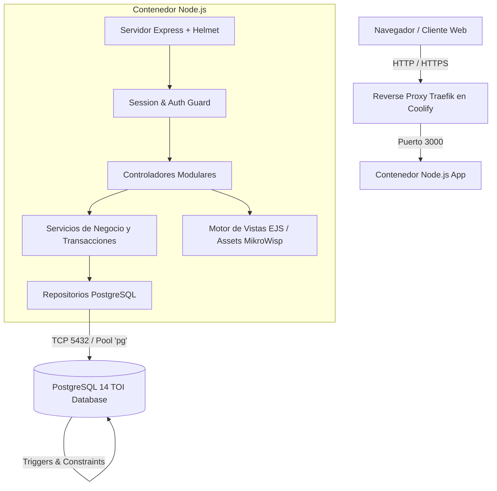

# TECHNICAL PLAN: Sistema de Almacén TOI v4.0 (Node.js & TypeScript)
<!-- Spec Kit Technical Plan -->

**Identificador:** `PLAN-001`  
**Referencia:** `SPEC-001`  
**Tecnología Base:** Node.js v22 LTS / TypeScript 5 / PostgreSQL 14+ / Docker  

---

## 1. Arquitectura del Sistema

El sistema se estructura como un servicio monolítico modular en **Node.js** con tipado estricto en **TypeScript**, diseñado para máximo rendimiento, bajo consumo de memoria (< 70MB en contenedor) y simplicidad de mantenimiento.



---

## 2. Stack Tecnológico Seleccionado

| Componente | Tecnología | Justificación Técnica |
|---|---|---|
| **Runtime & Lenguaje** | Node.js 22 LTS + TypeScript 5 | Tipado estricto en entidades, ejecución asíncrona ultra rápida, ecosistema moderno. |
| **Framework HTTP** | Express 4.x / 5.x | Extremadamente estable, soporta SSR inmediato con DataTables y API REST sin sobrecarga. |
| **Acceso a Datos** | `pg` (node-postgres) con `pg-pool` | Conexión directa y de máximo rendimiento a PostgreSQL 14, reutilizando íntegramente las tablas y secuencias existentes. |
| **Motor de Vistas (SSR)** | EJS con layouts modulares | Permite renderizar la interfaz MikroWisp limpia sin hidrataciones pesadas de frontend SPA, con carga instantánea (<50ms). |
| **Seguridad & Sesiones** | `express-session` + `connect-pg-simple` + `bcryptjs` + `helmet` | Compatible con los hashes existentes de los usuarios; sesiones almacenadas en la tabla `app_sessions` de PostgreSQL. |
| **Generación de Reportes** | `exceljs` + `pdfkit` / `jspdf` | Reemplazo limpio y nativo de TCPDF y PHPExcel sin dependencias externas del sistema operativo. |
| **Contenerización** | Docker Multi-Stage + Docker Compose | Imagen final de ~180MB en base Alpine/Slim, lista para despliegue en 1 clic en Coolify. |

---

## 3. Esquema de Base de Datos y Compatibilidad

La base de datos se basa en el volcado [backup_almacen_toi20261114.sql](file:///c:/Users/raul1/Desktop/soporte/proyectos%20desarrollo/almacen%20v2/backup_almacen_toi20261114.sql). No se modifica el esquema para garantizar cero pérdida de datos:

1. `usuarios`: Autenticación con `password_hash` bcrypt.
2. `equipos`: Llave primaria `id_equipo`, clave foránea a `tipos_equipos(codigo)` e `id_tipo_equipo`.
3. `accesorios`: Control de existencias, unidad de medida, relación con proveedores.
4. `movimientos_equipos`: Registro con `numero_serie_mac`, `tipo_movimiento`, `destino`, `encargado`, `asunto`, `observaciones`.
5. `movimientos_accesorios`: Registro con `id_accesorio`, `cantidad`, `tipo_movimiento`, `destino` (habilitado), `encargado`, `asunto`.
6. `tipos_equipos`: Identificador `id_codigo`, `codigo`, `prefijo`, `descripcion`, `categoria`.
7. `proveedores`: Campo `nit`, `nombre_empresa`, `telefono`, `correo`, etc.
8. `app_sessions`: Tabla de sesiones persistentes para que las sesiones no se pierdan al reiniciar contenedores en Coolify.

---

## 4. Estructura del Proyecto Node.js

```
almacen-node/
├── src/
│   ├── config/             # Variables de entorno y configuración de conexión
│   │   ├── env.ts
│   │   └── database.ts
│   ├── db/                 # Pool PostgreSQL y cliente
│   │   └── index.ts
│   ├── middlewares/        # Autenticación, control de roles, manejo de errores
│   │   ├── auth.middleware.ts
│   │   └── error.middleware.ts
│   ├── models/             # Tipos TypeScript e interfaces de dominio
│   │   ├── usuario.model.ts
│   │   ├── equipo.model.ts
│   │   ├── accesorio.model.ts
│   │   └── movimiento.model.ts
│   ├── repositories/       # Consultas SQL seguras y parametrizadas
│   │   ├── usuario.repository.ts
│   │   ├── equipo.repository.ts
│   │   ├── accesorio.repository.ts
│   │   ├── movimiento.repository.ts
│   │   └── maestro.repository.ts
│   ├── controllers/        # Controladores HTTP
│   │   ├── auth.controller.ts
│   │   ├── dashboard.controller.ts
│   │   ├── equipos.controller.ts
│   │   ├── accesorios.controller.ts
│   │   ├── movimientos.controller.ts
│   │   ├── maestros.controller.ts
│   │   └── reportes.controller.ts
│   ├── views/              # Vistas EJS compactas con diseño MikroWisp
│   │   ├── layouts/
│   │   │   ├── header.ejs
│   │   │   ├── footer.ejs
│   │   │   └── sidebar.ejs
│   │   ├── auth/
│   │   ├── dashboard/
│   │   ├── equipos/
│   │   ├── accesorios/
│   │   ├── movimientos/
│   │   └── maestros/
│   ├── public/             # CSS sobrio unificado, scripts limpios, favicon
│   │   ├── css/
│   │   │   └── mikrowisp-style.css
│   │   └── js/
│   └── app.ts              # Inicialización de Express y rutas
│   └── server.ts           # Punto de entrada del servidor
├── package.json
├── tsconfig.json
├── Dockerfile              # Multi-stage build para Coolify
├── docker-compose.yml      # Definición de App + PostgreSQL 14 para Coolify
└── .env.example
```

---

## 5. Estrategia de Despliegue en Coolify

### 5.1. Dockerfile Multi-Etapa
- **Etapa 1 (`builder`)**: Instala dependencias completas, compila TypeScript (`tsc`), genera bundles CSS y compila vistas a `dist/`.
- **Etapa 2 (`runner`)**: Usa `node:22-alpine`, instala únicamente `dependencies` de producción, copia `dist/` y `public/`, establece usuario `node` (no root) y expone el puerto 3000.

### 5.2. Docker Compose para Coolify
```yaml
services:
  app:
    build: .
    restart: always
    environment:
      - NODE_ENV=production
      - PORT=3000
      - DATABASE_URL=postgresql://${DB_USER:-almacen_toi}:${DB_PASS:-almacen_secret}@db:5432/${DB_NAME:-almacen_toi}
      - SESSION_SECRET=${SESSION_SECRET:-toi_super_secure_session_key_2026}
    depends_on:
      db:
        condition: service_healthy
    ports:
      - "${APP_PORT:-3000}:3000"

  db:
    image: postgres:14-alpine
    restart: always
    environment:
      - POSTGRES_DB=${DB_NAME:-almacen_toi}
      - POSTGRES_USER=${DB_USER:-almacen_toi}
      - POSTGRES_PASSWORD=${DB_PASS:-almacen_secret}
    volumes:
      - pgdata:/var/lib/postgresql/data
      - ../backup_almacen_toi20261114.sql:/docker-entrypoint-initdb.d/01-backup.sql:ro
    healthcheck:
      test: ["CMD-SHELL", "pg_isready -U ${DB_USER:-almacen_toi} -d ${DB_NAME:-almacen_toi}"]
      interval: 5s
      timeout: 5s
      retries: 5

volumes:
  pgdata:
```
