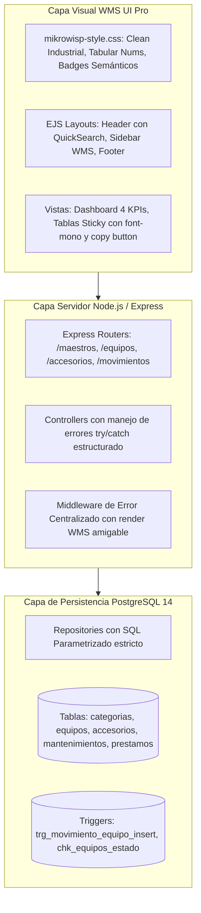

# TECHNICAL PLAN: Estabilización de Flujos y Rediseño WMS UI Pro
<!-- Spec Kit Technical Plan: PLAN-002 -->

**Identificador:** `PLAN-002`  
**Referencia:** `SPEC-002`  
**Skill de Referencia:** `.agents/skills/wms-ui-pro/SKILL.md`  
**Base Tecnológica:** Node.js 22 LTS / Express / PostgreSQL 14+ / EJS / WMS Clean Industrial UI  

---

## 1. Arquitectura Técnica y Estrategia de Refactorización

Para garantizar que el sistema cumpla con los estándares de **WMS UI Pro** y solvente los fallos de esquema de base de datos, la implementación se organiza en tres capas técnicas:



---

## 2. Plan Detallado por Componentes

### 2.1. Backend: Estabilización de Consultas y Esquemas de Base de Datos

1. **`src/repositories/maestro.repository.ts`**:
   - **`getCategorias()`**: Reemplazar `accesorios.id_tipo_accesorio` por `accesorios.id_categoria`.
   - **`createMantenimiento(data)`**: 
     - Mapear a columnas reales: `id_equipo`, `tipo_mantenimiento` (`PREVENTIVO`, `CORRECTIVO`, `EVOLUTIVO`), `descripcion`, `costo`, `tecnico_responsable`, `fecha_ingreso`, `estado` (`EN_PROCESO`, `COMPLETADO`, `CANCELADO`), `repuestos_cambiados`, `observaciones`.
   - **`createPrestamo(data)`**:
     - Mapear a columnas reales: `id_equipo`, `numero_serie_mac`, `nombre_solicita`, `motivo_prestamo`, `fecha_prestamo`, `fecha_devolucion_esperada`, `observaciones_salida`, `estado` (`PRESTADO`, `DEVUELTO`, `ATRASADO`, `PERDIDO`).

2. **`src/repositories/accesorio.repository.ts`**:
   - **`create(data)`**: Validar y forzar `fecha_entrada: data.fecha_entrada || new Date().toISOString().split('T')[0]`.

3. **`src/models/types.ts`**:
   - Actualizar interfaces `Categoria`, `Mantenimiento`, `Prestamo` y `Equipo` para concordar con los tipos y restricciones `CHECK` de PostgreSQL.

4. **`src/middlewares/error.middleware.ts`**:
   - Implementar vista amigable de error (`500.ejs` y `404.ejs`) con diseño WMS Clean Industrial, evitando exponer stack traces al operador en producción.

---

### 2.2. Frontend: Sistema de Diseño WMS UI Pro (`src/public/css/mikrowisp-style.css`)

1. **Tokens y Paleta Base**:
   - Fondo de trabajo: `#F8FAFC`
   - Superficie de tarjetas y tablas: `#FFFFFF`
   - Bordes de división: `1px solid #E2E8F0`
   - Texto principal: `#0F172A` (Slate 900)
   - Texto secundario: `#64748B` (Slate 500)
   - Sombras de ingeniería sutiles: `box-shadow: 0 1px 2px 0 rgba(0, 0, 0, 0.05);`

2. **Badges Semánticos de Inventario**:
   ```css
   .badge-stock-optimo { background: #DCFCE7; color: #166534; border: 1px solid #BBF7D0; }
   .badge-stock-bajo { background: #FEF3C7; color: #92400E; border: 1px solid #FDE68A; }
   .badge-stock-critico { background: #FEE2E2; color: #991B1B; border: 1px solid #FECACA; }
   .badge-stock-transito { background: #E0F2FE; color: #075985; border: 1px solid #BAE6FD; }
   ```

3. **Tipografía Operativa y Números Tabulares**:
   - `.font-tabular`: `font-variant-numeric: tabular-nums;` en todas las celdas de stock, precios, fechas y métricas.
   - `.font-mono-sku`: Fuente monoespaciada (`JetBrains Mono`, `Consolas`, monospace) con contenedor de copiado rápido al portapapeles.

4. **Tablas de Alto Rendimiento**:
   - Cabeceras fijas `.table-sticky-header th { position: sticky; top: 0; background: #F8FAFC; z-index: 10; border-bottom: 2px solid #CBD5E1; }`.
   - Alineación rigurosa: `.text-left` para descripciones, `.text-right` para números/montos, `.text-center` para estados.
   - Acciones compactas por fila con iconos directos y áreas táctiles mínimas de 36px/44px.

---

### 2.3. Vistas y Plantillas EJS

1. **Dashboard (`src/views/dashboard/index.ejs`)**:
   - Reducir a exactamente **4 tarjetas KPI**:
     1. Total Equipos en Sistema (Disponibles vs Ocupados)
     2. Accesorios con Stock Crítico (< 10) con enlace directo a filtro
     3. Movimientos Registrados (Egresos vs Ingresos)
     4. Equipos en Mantenimiento / Taller
   - Lista inferior con últimos 10 movimientos y accesos rápidos a operaciones.

2. **Gestión Maestra > Categorías (`src/views/maestros/categorias.ejs`)**:
   - Tabla con encabezado fijo, conteo de equipos y accesorios vinculados, badge de estado activo/inactivo y modal de creación/edición.

3. **Mantenimientos y Préstamos (`src/views/maestros/mantenimientos.ejs`, `prestamos.ejs`)**:
   - Formularios adaptados a las columnas reales validadas en PostgreSQL.

4. **Inventarios y Formularios de Movimientos (`equipos/index.ejs`, `accesorios/index.ejs`, `movimientos/*.ejs`)**:
   - Búsqueda con autofocus, lector de código de barras, números tabulares alineados a la derecha y validación visual inmediata de stock.

---

## 3. Plan de Pruebas y Verificación

1. **Prueba de regresión SQL y endpoints**:
   - `GET /maestros/categorias` -> HTTP 200 con 7 categorías cargadas.
   - `GET /dashboard` -> HTTP 200 con 4 tarjetas KPI calculadas.
   - `GET /equipos` y `GET /accesorios` -> HTTP 200 con tabla WMS UI Pro.
   - `POST /accesorios` -> Inserción limpia con `fecha_entrada` por defecto.
   - `POST /maestros/mantenimientos` y `POST /maestros/prestamos` -> Inserciones sin errores de columna.

2. **Auditoría visual y ergonomía**:
   - Verificar `font-variant-numeric: tabular-nums` en inspectores de estilo.
   - Verificar cero scroll horizontal en ventana principal (`overflow-x: hidden` en contenedor principal y `overflow-x: auto` en contenedor de tabla).
   - Verificar paleta `#F8FAFC` y badges semánticos.
