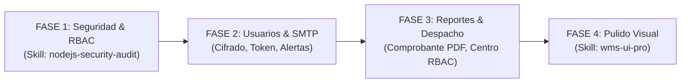

# SPECIFICATION: Seguridad Avanzada, Control de Acceso RBAC, Gestión de Usuarios, Servidor SMTP y Centro de Reportes por Rol
<!-- Spec Kit Specification Document: SPEC-003 -->

**Identificador:** `SPEC-003`  
**Título:** Seguridad Integral OWASP, Control de Acceso por Roles (RBAC), Administración de Usuarios, Servicio de Notificaciones SMTP y Centro de Reportes con Comprobante de Despacho  
**Estado:** `Propuesto`  
**Fecha:** Noviembre 2026  
**Skills de Referencia:**  
- [`.agents/skills/nodejs-security-audit/SKILL.md`](file:///c:/Users/raul1/Desktop/soporte/proyectos%20desarrollo/almacen%20v2/.agents/skills/nodejs-security-audit/SKILL.md) (Auditoría SAST, Hardening Express, RBAC, IDOR, Criptografía)
- [`.agents/skills/wms-ui-pro/SKILL.md`](file:///c:/Users/raul1/Desktop/soporte/proyectos%20desarrollo/almacen%20v2/.agents/skills/wms-ui-pro/SKILL.md) (AdminLTE v4, Bootstrap 5.3, Multi-Tema Claro/Noche/Alto Contraste, Modales Full-Width)  
**Base Tecnológica:** Node.js 22 LTS / Express / PostgreSQL 14+ / TypeScript / AdminLTE 4 / EJS / Nodemailer / PDFKit  

---

## 1. Resumen Ejecutivo y Motivación

Con la estabilización técnica del sistema migrado de PHP a Node.js y la adopción de la interfaz estándar AdminLTE 4 ([`SPEC-002`](file:///c:/Users/raul1/Desktop/soporte/proyectos%20desarrollo/almacen%20v2/.specify/specs/002-estabilizacion-y-redisenio-wms-ui-pro/spec.md)), el Sistema de Almacén TOI requiere blindar su arquitectura de seguridad, regular el acceso por responsabilidades y dotar a la operación de capacidades avanzadas de auditoría, trazabilidad y comunicación transaccional.

Para erradicar retrabajo y colisiones entre capas lógicas, esta especificación se divide en **cuatro fases secuenciales con dependencias estrictas**:



1. **Fase 1 (Seguridad Base y RBAC Backend)**: Antes de desarrollar módulos nuevos, se audita y protege el núcleo de la aplicación contra inyección SQL, Cross-Site Scripting (XSS), manipulación de sesiones y ataques de fuerza bruta. Se establece el middleware centralizado de **Control de Acceso Basado en Roles (RBAC)** diferenciando `admin` y `usuario`, garantizando que ninguna ruta sea vulnerable a elevación de privilegios o **Insecure Direct Object References (IDOR)**.
2. **Fase 2 (Usuarios y Servidor SMTP Transaccional)**: Sobre el RBAC ya activo, se perfecciona la gestión de cuentas (altas, roles, bajas lógicas y reseteo de contraseñas seguras con bcrypt) y se implementa el subsistema de correo electrónico empresarial (credenciales cifradas con `AES-256-GCM`, test interactivo de transporte y 3 flujos automatizados: recuperación de cuenta, alerta por stock crítico y despacho de reportes).
3. **Fase 3 (Comprobante de Despacho y Centro de Reportes)**: Al completar cualquier egreso de inventario se genera inmediatamente un comprobante formal descargable/imprimible en PDF con trazabilidad de series y firmas de conformidad. Adicionalmente se construye el Centro de Reportes segmentado por rol: global y multi-criterio para Administradores; restringido estricta e inviolablemente a "Mis Movimientos" para Usuarios operativos.
4. **Fase 4 (Pulido Visual e Integración WMS UI Pro)**: Todas las interfaces nuevas adoptan la arquitectura de AdminLTE 4 sin fondos blancos fijos, compatible con los 3 temas (Claro, Noche y Alto Contraste), tablas al 100% de ancho con formularios en modales y corrección del ancho de columnas en el Dashboard.

---

## 2. Historias de Usuario (User Stories)

### US-1: Oficial de Seguridad / AppSec - Aplicación Blindada y Conforme a OWASP Top 10
* **Como** responsable de seguridad de la infraestructura tecnológica de TOI,  
* **Quiero** que todas las rutas de Express cuenten con cabeceras de seguridad Helmet, rate-limiting contra ataques de fuerza bruta en autenticación, sesiones HTTP con cookies seguras y consultas 100% parametrizadas,  
* **Para** prevenir fugas de información, robo de sesiones, inyecciones de código y accesos no autorizados al inventario crítico de telecomunicaciones.

### US-2: Administrador del Sistema - Control Centralizado de Personal y Configuración SMTP
* **Como** administrador principal del almacén,  
* **Quiero** administrar las cuentas del personal técnico mediante modales flotantes (asignando rol de Operador o Administrador, habilitando/deshabilitando accesos y forzando cambios seguros de contraseña) y configurar los parámetros del servidor SMTP con contraseñas cifradas y pruebas de conexión en vivo,  
* **Para** asegurar que solo personal autorizado opere el sistema y que las notificaciones críticas por stock agotado y recuperaciones de contraseña se entreguen sin fallos.

### US-3: Operador de Bodega - Entrega Respaldada y Recuperación Autónoma de Acceso
* **Como** operador de turno en bodega o despacho,  
* **Quiero** poder restablecer mi contraseña mediante un enlace seguro por correo si olvido mis credenciales y, al despachar equipos o fibra, obtener inmediatamente un comprobante PDF con el detalle de números de serie y recuadros de firma para el técnico receptor,  
* **Para** agilizar la entrega en ventanilla y contar con un documento formal firmado que respalde mi responsabilidad sobre el material entregado.

### US-4: Supervisor Logístico / Administrador - Auditoría de Movimientos Multi-criterio
* **Como** supervisor de logística y finanzas,  
* **Quiero** consultar en una pantalla unificada todos los movimientos del almacén filtrando por rangos de fechas, operadores, destinos, categorías o tipos de transacción, pudiendo exportar los datos a PDF o Excel,  
* **Para** auditar la rotación de hardware, supervisar el desempeño de cada técnico y detectar anomalías en la salida de materiales.

### US-5: Usuario Operador - Consulta Exclusiva de Mis Movimientos (Prevención de IDOR)
* **Como** operador técnico con rol `usuario`,  
* **Quiero** visualizar y exportar únicamente los movimientos y comprobantes generados por mi propio usuario en el sistema,  
* **Para** llevar el control de mis entregas del día sin tener acceso indebido ni visibilidad sobre los registros privados de otros compañeros o de la administración general.

---

## 3. Matriz de Roles y Permisos (RBAC & IDOR Matrix)

| Módulo / Funcionalidad | Ruta HTTP / Acción | Rol Administrador (`admin`) | Rol Usuario (`usuario`) | Control de Seguridad |
| :--- | :--- | :---: | :---: | :--- |
| **Dashboard General** | `GET /dashboard` | Acceso Total (4 KPIs globales) | Acceso Operativo | Vista adaptada |
| **Catálogo de Equipos** | `GET /equipos` | Consulta y Exportación | Consulta | `requireAuth` |
| **Alta / Edición de Equipos** | `POST /equipos/nuevo`, `/editar/:id` | Permitido | Denegado (403) | `requireAdmin` |
| **Baja / Retiro de Equipos** | `GET /equipos/eliminar/:id` | Permitido | Denegado (403) | `requireAdmin` |
| **Catálogo de Materiales** | `GET /accesorios` | Consulta y Exportación | Consulta | `requireAuth` |
| **Alta / Edición de Materiales**| `POST /accesorios/nuevo`, `/editar/:id`| Permitido | Denegado (403) | `requireAdmin` |
| **Movimientos de Equipos** | `GET/POST /movimientos/equipos` | Registro y Consulta Global | Registro y Consulta | Guarda `created_by = session.userId` |
| **Movimientos de Materiales**| `GET/POST /movimientos/accesorios` | Registro y Consulta Global | Registro y Consulta | Guarda `created_by = session.userId` |
| **Comprobante Despacho PDF** | `GET /movimientos/comprobante/:id` | Descarga de cualquier remisión | Solo si `created_by == session.userId` | **Anti-IDOR estricto** en Backend |
| **Gestión Maestra (Catálogos)**| `/maestros/*` (Categorías, Proveedores, etc.) | CRUD Completo | Solo lectura o Restringido | `requireAdmin` para mutaciones |
| **Gestión de Usuarios** | `GET/POST /usuarios/*` | Acceso Total | Denegado (403 / Redirige) | `requireAdmin` |
| **Configuración Servidor SMTP**| `GET/POST /configuracion/smtp/*` | Configuración y Envío de Test | Denegado (403 / Redirige) | `requireAdmin` |
| **Centro de Reportes** | `GET /reportes` | Filtro Global (todos los usuarios) | Restringido a "Mis Movimientos" | Inyección forzada de `session.userId` |
| **Exportación de Reportes** | `GET /reportes/exportar/*` | Exportación Global Completa | Exportación filtrada a su autoría | Inyección forzada de `session.userId` |

---

## 4. Requisitos Detallados por Fases Secuenciales

### FASE 1: Auditoría de Seguridad y Control de Acceso (Skill: nodejs-security-audit)

#### 4.1. Requisitos Funcionales (Fase 1)
- **REQ-SEC-01 (Auditoría SAST y Erradicación de Inyección SQL)**:
  - Verificar que el 100% de las sentencias SQL en todos los repositorios (`src/repositories/`) utilicen consultas preparadas parametrizadas de PostgreSQL (`$1, $2, ...`) mediante `pool.query(sql, [params])`.
  - Queda estrictamente prohibida la concatenación de variables mediante literales de plantilla (`` `WHERE campo = '${var}'` ``) o concatenación manual con `+`.
- **REQ-SEC-02 (Protección contra Cross-Site Scripting - XSS)**:
  - Auditar todas las plantillas EJS (`src/views/`) para garantizar que cualquier dato provisto por usuarios o base de datos (nombres, series, descripciones, motivos, observaciones) se imprima con escape HTML automático (`<%= %>`).
  - El uso de evaluación cruda (`<%- %>`) se reservará única y exclusivamente para includes de layout (`<%- include(...) %>`).
- **REQ-SEC-03 (Hardening de Sesiones y Cookies)**:
  - Configurar las cookies de sesión en `connect-pg-simple` / `express-session` con:
    * `httpOnly: true` (inmune a lectura vía JavaScript / XSS).
    * `sameSite: 'lax'` (protección activa contra ataques Cross-Site Request Forgery - CSRF).
    * `secure: true` dinámico si la conexión es HTTPS o en producción tras proxy reverso (`app.set('trust proxy', 1)`).
    * Regeneración de ID de sesión tras el login exitoso para prevenir fijación de sesión (*session fixation*).
- **REQ-SEC-04 (Protección de Cabeceras HTTP con Helmet)**:
  - Configurar `helmet` en `src/app.ts` activando `xContentTypeOptions`, `dnsPrefetchControl`, `frameguard: { action: 'sameorigin' }`, `hidePoweredBy` y `xssFilter`.
- **REQ-SEC-05 (Defensa contra Fuerza Bruta con Rate Limiting)**:
  - Integrar el paquete `express-rate-limit` con limitadores específicos:
    * **Limitador de Autenticación (`/auth/login`, `/auth/forgot-password`)**: Máximo 5 intentos por ventana de 15 minutos por dirección IP.
    * **Limitador de Correos (`/api/test-smtp`, reenvíos)**: Máximo 3 peticiones por minuto.
    * **Limitador Global de API**: Máximo 100 peticiones por minuto.
- **REQ-SEC-06 (Sistema RBAC Centralizado en Middleware)**:
  - Implementar en `src/middlewares/auth.middleware.ts` los siguientes middlewares declarativos:
    ```typescript
    export function requireAuth(req: Request, res: Response, next: NextFunction);
    export function requireRole(allowedRoles: Array<'admin' | 'usuario'>);
    export function requireAdmin(req: Request, res: Response, next: NextFunction);
    ```
  - Si un usuario con rol `usuario` intenta acceder a una ruta administrativa, el sistema responderá con código HTTP `403 Forbidden` renderizando la pantalla de aviso de permisos insuficientes o mensaje flash preventivo, sin ejecutar la lógica del controlador.
- **REQ-SEC-07 (Prevención Incondicional de IDOR en Backend)**:
  - Todas las operaciones sensibles que impliquen consulta o exportación de comprobantes o movimientos personales deben validar en el backend que el registro pertenezca al `id_usuario` de la sesión activa, salvo que la sesión posea rol `admin`.

#### 4.2. Entregable Documental de Seguridad
- Generar el documento [`.specify/specs/003-seguridad-usuarios-smtp-reportes/vulnerabilities-audit.md`](file:///c:/Users/raul1/Desktop/soporte/proyectos%20desarrollo/almacen%20v2/.specify/specs/003-seguridad-usuarios-smtp-reportes/vulnerabilities-audit.md) clasificando cada hallazgo bajo severidad (**Crítica, Alta, Media, Baja**), indicando archivo, línea afectada, vector de ataque y solución aplicada.

---

### FASE 2: Gestión de Usuarios y Servidor SMTP Transaccional

#### 4.3. Requisitos Funcionales: Módulo de Usuarios
- **REQ-USR-01 (CRUD de Usuarios en Modal Flotante AdminLTE)**:
  - La pantalla `/usuarios` mantendrá la tabla full-width (`col-12`) y gestionará las operaciones en ventanas modales (`modal fade modal-dialog-centered`):
    * **Creación**: Nombre completo, nombre de usuario (único, validado en backend), contraseña inicial, carnet/CI, rol (`admin` o `usuario`), correo electrónico y fecha de nacimiento.
    * **Edición**: Modal para modificar datos personales y cambio de rol.
    * **Activación / Desactivación**: Botón interactivo para alternar el estado `activo = 1` (Habilitado) o `activo = 0` (Inhabilitado). Si una cuenta se desactiva, cualquier sesión abierta de dicho usuario debe ser destruida en la siguiente petición mediante el middleware `attachUserMiddleware`.
- **REQ-USR-02 (Gestión Segura de Contraseñas con Bcrypt)**:
  - Todas las contraseñas se almacenarán exclusivamente como hash `bcrypt` con un costo de trabajo (*salt rounds*) no menor a 10.
  - Prohibido almacenar contraseñas en texto plano o retornar el campo `password_hash` en consultas o respuestas JSON de usuario.

#### 4.4. Requisitos Funcionales: Módulo Servidor SMTP
- **REQ-SMTP-01 (Esquema y Almacenamiento Persistente de Configuración SMTP)**:
  - Crear la tabla en PostgreSQL `configuracion_smtp`:
    ```sql
    CREATE TABLE IF NOT EXISTS configuracion_smtp (
      id SERIAL PRIMARY KEY,
      host VARCHAR(255) NOT NULL,
      puerto INTEGER NOT NULL DEFAULT 587,
      usuario VARCHAR(255),
      password_cifrado TEXT,
      secure BOOLEAN NOT NULL DEFAULT FALSE,
      remitente_email VARCHAR(255) NOT NULL,
      remitente_nombre VARCHAR(255) NOT NULL DEFAULT 'Almacén TOI',
      activo BOOLEAN NOT NULL DEFAULT TRUE,
      updated_at TIMESTAMP NOT NULL DEFAULT CURRENT_TIMESTAMP
    );
    ```
- **REQ-SMTP-02 (Cifrado Simétrico de Credenciales de Correo con AES-256-GCM)**:
  - Siguiendo los principios de `nodejs-security-audit`, la contraseña de la casilla SMTP jamás se almacenará en texto plano en la base de datos.
  - Se creará un helper de cifrado simétrico en `src/utils/crypto.helper.ts` utilizando el algoritmo estándar `AES-256-GCM` y la clave secreta `ENCRYPTION_KEY` definida en el entorno `.env` (32 bytes). Al guardar, se almacena `iv + authTag + ciphertext` en formato hexadecimal. Al conectar, se descifra en memoria para inicializar el transporte de Nodemailer.
- **REQ-SMTP-03 (Interfaz de Configuración SMTP y Prueba de Conexión en Vivo)**:
  - Vista exclusiva para Administradores en `/configuracion/smtp`.
  - Formulario en tarjeta AdminLTE 4 con campos para: Host, Puerto, Seguridad (TLS / STARTTLS / Ninguno), Usuario, Contraseña, Correo Remitente y Nombre Visible.
  - Botón interactivo **"Probar Conexión / Enviar Correo de Prueba"**:
    * Solicita un correo destinatario mediante modal o campo.
    * Valida el handshake SMTP y las credenciales mediante `transporter.verify()`.
    * Envía un correo con diseño corporativo TOI confirmando el enlace operativo.
    * Notifica al administrador con un toast/alerta de éxito o mensaje de error detallado en caso de rechazo del servidor de correo.

#### 4.5. Requisitos Funcionales: Flujos Automatizados sobre SMTP
- **REQ-SMTP-04 (Flujo 1: Recuperación Segura de Contraseña desde Login)**:
  - En la vista de login (`/auth/login`) se habilitará el enlace `"¿Olvidaste tu contraseña?"` conduciendo a `/auth/forgot-password`.
  - El usuario ingresa su correo electrónico o usuario registrado.
  - El backend genera un token de un solo uso criptográficamente robusto:
    ```typescript
    const rawToken = crypto.randomBytes(32).toString('hex');
    const hashedToken = crypto.createHash('sha256').update(rawToken).digest('hex');
    const expires = new Date(Date.now() + 15 * 60 * 1000); // Expiración exacta de 15 minutos
    ```
  - Se almacena `hashedToken` y `expires` en `usuarios.reset_token` y `usuarios.reset_token_expires`.
  - Se despacha un correo HTML responsive con botón directo al enlace:
    `${APP_URL}/auth/reset-password?token=${rawToken}`.
  - Al abrir el enlace, el sistema valida la existencia, no-expiración y hash del token, permitiendo establecer una nueva contraseña. Al actualizarse, se anula el token inmediatamente para impedir reutilización (*one-time token*).
- **REQ-SMTP-05 (Flujo 2: Alertas Automáticas por Stock Crítico)**:
  - Al procesar con éxito una salida de accesorios (`/movimientos/accesorios`) o un egreso de equipo (`/movimientos/equipos`):
    * El sistema verifica si el stock restante del ítem es menor o igual al umbral crítico (`stock <= 10` o menor a su stock mínimo).
    * Si la condición se cumple y el servicio SMTP está activo, se dispara de forma asíncrona (en segundo plano, sin demorar la respuesta HTTP del operador) un correo de alerta a la dirección o lista de supervisores configurada en el sistema con el detalle del artículo, cantidad remanente y técnico que retiró el material.
- **REQ-SMTP-06 (Flujo 3: Envío de Reportes por Correo)**:
  - Desde los módulos de reportes y despachos, el operador o administrador podrá marcar la casilla *"Enviar copia por correo"* e indicar una o más direcciones de correo para adjuntar el comprobante o reporte generado.

---

### FASE 3: Reportes en Despacho y Centro de Reportes por Rol

#### 4.6. Requisitos Funcionales: Reporte Transaccional de Despacho (Comprobante de Entrega)
- **REQ-REP-01 (Generación Inmediata de Comprobante de Entrega)**:
  - Al confirmar un movimiento de tipo `SALIDA` en Equipos o Materiales, la respuesta visual incluirá un acceso directo destacado: **"Descargar Comprobante de Entrega (PDF)"** y **"Imprimir Remisión"**, con ruta `GET /movimientos/comprobante/:id`.
- **REQ-REP-02 (Estructura y Formato del Comprobante PDF)**:
  - Generado en formato estándar de página media carta / carta mediante `pdfkit` o motor de renderizado de documentos server-side:
    * Encabezado institucional con membrete: **Telecomunicaciones Oportunas Inteligentes (TOI)**, NIT, fecha y hora exacta del despacho.
    * Identificador único de comprobante: `N° REM-YYYYMMDD-XXXX`.
    * Datos de la Operación: Destino / Proyecto / Área asignada, Motivo / Asunto (RCA, Instalación, etc.), y Nombre del Operador de Almacén emisor.
    * Tabla detallada de bienes entregados:
      - Para Equipos: Código, Nombre del Producto, Modelo, Marca, y **N° de Serie / MAC** en tipografía monoespaciada legible.
      - Para Materiales / Fibra: Código SKU, Descripción, Cantidad y Unidad de Medida (ej. Metros, Cajas, Unidades).
    * Cláusula estándar de recepción y custodia técnica del material.
    * **Espacio formal de firmas**:
      - Recuadro izquierdo: *"Entregado por (Almacén)"* (Firma, Aclaración de Nombre y Carnet).
      - Recuadro derecho: *"Recibido Conforme (Técnico / Responsable)"* (Firma, Aclaración y Carnet).
- **REQ-REP-03 (Acceso y Seguridad del Comprobante - Anti-IDOR)**:
  - Un usuario con rol `admin` puede descargar o reimprimir cualquier comprobante histórico.
  - Un usuario con rol `usuario` únicamente puede descargar comprobantes donde el campo `created_by` coincida con su propio `session.userId`. Si manipula el ID en la URL (`/movimientos/comprobante/999`), el backend verificará la propiedad del registro y retornará `403 Forbidden` impidiendo la fuga de datos.

#### 4.7. Requisitos Funcionales: Centro de Reportes Multi-criterio (`/reportes`)
- **REQ-REP-04 (Consolidación del Centro de Reportes Unificado)**:
  - Unificar las consultas dispersas en una nueva vista central `/reportes` con interfaz AdminLTE 4, tarjeta de filtros multi-criterio y tabla de resultados dinámica.
- **REQ-REP-05 (Capacidades del Rol Administrador en Reportes)**:
  - Filtros combinables:
    * Rango de fechas: Desde [AAAA-MM-DD] hasta [AAAA-MM-DD].
    * Tipo de movimiento: Todos, `ENTRADA`, `SALIDA`, `MANTENIMIENTO`, `PRESTAMO`, `REVISION`.
    * Categoría: Todas o categoría específica (Router, Switch, Fibra, etc.).
    * Destino: Todos o área puntual (Instalaciones, Infraestructura, Nodos, etc.).
    * Operador / Usuario ejecutor: Selector con todos los usuarios del sistema.
    * Búsqueda por texto: Serie, MAC, código o nombre de material.
  - Tabla de resultados con paginación limpia y badges semánticos.
  - Botones de exportación masiva: **Exportar a PDF** (con formato membretado de reporte consolidado) y **Exportar a Excel / CSV** (con tipos de datos numéricos y fechas tabulares).
- **REQ-REP-06 (Restricción del Rol Usuario en Reportes - "Mis Movimientos")**:
  - Cuando un usuario con rol `usuario` ingresa a `/reportes`:
    * La vista se titula automáticamente **"Historial de Mis Movimientos"**.
    * El selector de "Operador" se oculta o se bloquea rígidamente con su propio nombre.
    * En el backend (`ReportesController`), la consulta SQL inyecta forzosamente la cláusula:
      `WHERE created_by = $userId` extrayendo el ID exclusivamente de `req.session.userId`, ignorando cualquier parámetro alterado en `req.query` o `req.body`.
    * Las exportaciones generadas para el rol `usuario` solo contendrán sus propios registros.

---

### FASE 4: Pulido Visual y Ergonomía (Skill: wms-ui-pro)

#### 4.8. Requisitos de Diseño e Interfaz (Fase 4)
- **REQ-UI-01 (Conformidad Visual con AdminLTE 4 y Multi-Tema)**:
  - Todas las nuevas pantallas desarrolladas en esta especificación:
    * `/usuarios` (Gestión de usuarios y modales de edición/clave).
    * `/configuracion/smtp` (Parámetros de correo y modal de prueba).
    * `/auth/forgot-password` y `/auth/reset-password` (Pantallas de recuperación de acceso).
    * `/reportes` (Centro de reportes y comprobantes de remisión).
  - Deben cumplir de forma estricta con las directrices de [`.agents/skills/wms-ui-pro/SKILL.md`](file:///c:/Users/raul1/Desktop/soporte/proyectos%20desarrollo/almacen%20v2/.agents/skills/wms-ui-pro/SKILL.md):
    * Prohibido hardcodear fondos blancos (`bg-white`, `bg-light`) o textos oscuros fijos (`text-dark`) en tarjetas, filtros o tablas.
    * Empleo obligatorio de clases adaptables: `bg-body`, `bg-body-tertiary`, `text-body`, `text-body-secondary`, `border`.
    * Soporte continuo a los tres temas activos: **Modo Claro**, **Modo Noche** y **Alto Contraste** (fondo `#000000`, bordes `#FFFFFF` y encabezados `#ffd700`).
- **REQ-UI-02 (Corrección de Ancho en Columna "DESTINO" del Dashboard)**:
  - En la vista principal del Dashboard (`src/views/dashboard/index.ejs`), en la tabla *"Últimos Movimientos Registrados"*:
    * La columna **"DESTINO"** actualmente experimenta recortes o compresión de texto al coexistir con la tarjeta lateral de resumen.
    * Se debe aplicar una distribución de anchos de columna balanceada (`th` con ancho mínimo de `130px`, contenedor responsivo `table-responsive` optimizado y badge con propiedad `text-truncate d-inline-block max-w-150` con tooltip nativo `title="..."`), garantizando que nombres como `INFRAESTRUCTURA`, `MANTENIMIENTO RED` y `MANTENIMIENTO VEHICULOS` se lean íntegros y nítidos sin cortes en monitores de escritorio ni tablets.
- **REQ-UI-03 (Formularios en Modales Flotantes Centrados)**:
  - Toda acción de creación o edición de usuarios, reseteo de claves y configuración de pruebas SMTP se desplegará en modales flotantes centrados (`modal fade modal-dialog-centered modal-lg`), manteniendo las tablas de datos al **100% de ancho horizontal (`col-12`)**.

---

## 5. Requisitos No Funcionales (NFR)

1. **Rendimiento y Generación Asíncrona (NFR-PERF)**:
   - El despacho de correos electrónicos (alertas de stock, notificaciones) jamás debe bloquear el hilo principal de Node.js ni retardar la respuesta HTTP del registro de inventario. Las tareas SMTP deben ejecutarse de forma asíncrona en background con captura de errores aislada.
2. **Cero Dependencia de Red en Componentes Visuales (NFR-OFFLINE)**:
   - Todo el soporte de interfaz (Bootstrap 5.3, AdminLTE 4, Bootstrap Icons) debe servirse localmente desde `node_modules` según lo establecido en `SPEC-002`, permitiendo la operación ininterrumpida en redes locales aisladas de almacén.
3. **Criptografía Robusta y Manejo de Claves (NFR-CRYPTO)**:
   - Las contraseñas de cuentas de usuario deben estar hasheadas con `bcrypt` (factor de costo 10+).
   - Los tokens de reseteo deben generarse con generador pseudoaleatorio criptográfico (`crypto.randomBytes(32)`).
   - Las contraseñas de correo SMTP deben cifrarse mediante `AES-256-GCM` garantizando confidencialidad e integridad autenticada.
4. **Compatibilidad y Cero Regresión Funcional (NFR-COMPAT)**:
   - Los usuarios existentes en la base de datos (como `admin` con contraseña `Admin123!`) deben poder iniciar sesión sin ninguna alteración ni necesidad de reinicialización de tablas.

---

## 6. Criterios de Aceptación por Fases (Definition of Done)

### Criterios de Aceptación: FASE 1 (Seguridad & RBAC)
- [ ] **CA-F1.1**: El 100% de las consultas SQL en repositorios están parametrizadas con `$1, $2, ...` y no existe ninguna concatenación de cadenas directas.
- [ ] **CA-F1.2**: El middleware `requireRole(['admin'])` bloquea con `403 Forbidden` cualquier intento de un usuario con rol `usuario` de acceder a `/usuarios`, `/configuracion/*` o rutas de eliminación.
- [ ] **CA-F1.3**: Las peticiones repetidas a `/auth/login` (más de 5 en 15 minutos) reciben HTTP `429 Too Many Requests` protegiendo contra fuerza bruta.
- [ ] **CA-F1.4**: Las cabeceras de respuesta HTTP incluyen las directivas de seguridad de Helmet (`X-Content-Type-Options: nosniff`, `X-Frame-Options: SAMEORIGIN`, etc.).
- [ ] **CA-F1.5**: Las sesiones son inmunes al robo por XSS (`HttpOnly: true`) y están protegidas contra CSRF (`SameSite: Lax`).
- [ ] **CA-F1.6**: El documento `vulnerabilities-audit.md` se encuentra redactado y archivado en la carpeta de la especificación.

### Criterios de Aceptación: FASE 2 (Usuarios & SMTP)
- [ ] **CA-F2.1**: La tabla `/usuarios` permite crear, editar y activar/desactivar cuentas desde modales flotantes sin recargar la página completa.
- [ ] **CA-F2.2**: Si una cuenta se marca como inactiva (`activo = 0`), sus credenciales son rechazadas en el login y cualquier sesión activa es desconectada inmediatamente.
- [ ] **CA-F2.3**: La configuración SMTP guarda los datos en base de datos con la contraseña cifrada simétricamente mediante `AES-256-GCM`.
- [ ] **CA-F2.4**: El botón de *"Probar Conexión"* en la vista SMTP ejecuta `verify()` y despacha un correo de prueba exitoso reportando el estado en pantalla.
- [ ] **CA-F2.5**: La opción *"¿Olvidaste tu contraseña?"* genera un token seguro de 15 minutos, despacha el enlace por correo y permite restablecer la contraseña con hash bcrypt.
- [ ] **CA-F2.6**: Al realizar una salida de equipo o material cuyo stock restante sea `<= 10`, se dispara automáticamente una alerta por correo a los administradores.

### Criterios de Aceptación: FASE 3 (Reportes & Despacho)
- [ ] **CA-F3.1**: Al registrar una salida de inventario, se habilita la descarga inmediata del Comprobante de Entrega en PDF (`/movimientos/comprobante/:id`).
- [ ] **CA-F3.2**: El comprobante PDF contiene número de remisión, fecha, detalle de series/cantidades, destino, operador emisor y recuadros formales de firma.
- [ ] **CA-F3.3**: Un usuario con rol `usuario` solo puede descargar sus propios comprobantes; cualquier intento de acceder al de otro usuario genera `403 Forbidden` (Anti-IDOR comprobado).
- [ ] **CA-F3.4**: El Centro de Reportes permite a los Administradores filtrar por rango de fechas, tipo, categoría, destino y operador, exportando a PDF y Excel.
- [ ] **CA-F3.5**: El Centro de Reportes para el rol `usuario` se autotitula *"Mis Movimientos"* y restringe forzosamente en SQL la consulta a sus propias operaciones.

### Criterios de Aceptación: FASE 4 (Pulido Visual AdminLTE 4)
- [ ] **CA-F4.1**: Todas las pantallas nuevas (`/usuarios`, `/configuracion/smtp`, `/reportes`, `/auth/forgot-password`) se adaptan impecablemente al cambiar entre Modo Claro, Modo Noche y Alto Contraste sin mostrar cajas blancas ni textos invisibles.
- [ ] **CA-F4.2**: Las tablas ocupan el 100% del ancho (`col-12`) y todos los formularios de acción se abren en modales flotantes centrados.
- [ ] **CA-F4.3**: En la tabla *"Últimos Movimientos Registrados"* del Dashboard, la columna **"DESTINO"** se visualiza completa, clara y sin desbordes ni cortes de texto.
