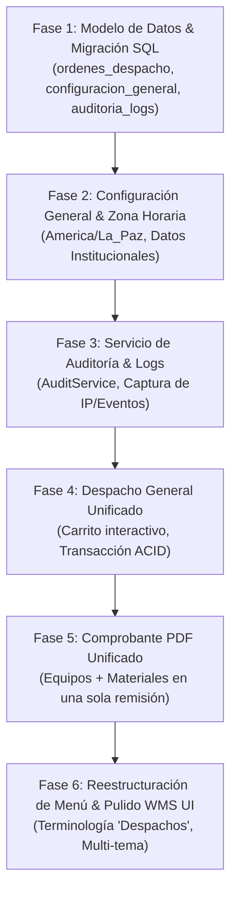

# PLAN TÉCNICO: Despacho General Unificado, Transaccionalidad ACID y Administración Centralizada
<!-- Spec Kit Plan Document: SPEC-004 -->

**Especificación:** [`SPEC-004`](file:///c:/Users/raul1/Desktop/soporte/proyectos%20desarrollo/almacen%20v2/.specify/specs/004-despacho-general-y-administracion/spec.md)  
**Skills Aplicadas:**  
- [`.agents/skills/wms-ui-pro/SKILL.md`](file:///c:/Users/raul1/Desktop/soporte/proyectos%20desarrollo/almacen%20v2/.agents/skills/wms-ui-pro/SKILL.md) (AdminLTE v4, Multi-Tema, Tablas Full-Width, Modales Flotantes)  
- [`.agents/skills/nodejs-security-audit/SKILL.md`](file:///c:/Users/raul1/Desktop/soporte/proyectos%20desarrollo/almacen%20v2/.agents/skills/nodejs-security-audit/SKILL.md) (Transacciones ACID, RBAC, Anti-IDOR, Audit Logs, Hardening)  

---

## 1. Arquitectura y Enfoque de Ejecución

Para evitar retrabajo y garantizar la estabilidad total del sistema durante la evolución funcional, el plan técnico se organiza en **6 fases secuenciales**:

---

## 2. Desglose de Fases de Implementación

### FASE 1: Migración de Base de Datos y Tipos TypeScript
1. **Script de Migración (`src/db/migrations/004_despacho_and_admin.sql`):**
   - Creación de tabla `ordenes_despacho` (cabecera de orden, correlativo, destino, receptor, estado).
   - Creación de tabla `ordenes_despacho_detalles` (ítems de tipo equipo o accesorio con descripción, series y cantidades).
   - Creación de tabla `configuracion_general` (zona horaria, datos institucionales, pie de firma, stock mínimo).
   - Creación de tabla `auditoria_logs` (bitácora inmutable de eventos con usuario, IP, módulo y acción).
   - Vinculación opcional en `movimientos_equipos` y `movimientos_accesorios` con `id_orden` y `numero_orden` para preservar el historial previo.
2. **Modelos y Tipos TypeScript (`src/models/types.ts`):**
   - Declaración de interfaces: `OrdenDespacho`, `OrdenDespachoDetalle`, `ConfiguracionGeneral`, `AuditoriaLog`, `ItemCarritoDespacho`.

### FASE 2: Configuración General del Sistema y Control de Zona Horaria
1. **Repositorio y Servicio (`ConfiguracionRepository`):**
   - Métodos `getConfiguracionGeneral()` y `updateConfiguracionGeneral()`.
   - Inicialización de zona horaria en el arranque de la aplicación (`process.env.TZ = config.zona_horaria || 'America/La_Paz'`).
2. **Controlador y Rutas (`ConfigController`):**
   - Rutas `GET /administracion/configuracion` y `POST /administracion/configuracion` protegidas estrictamente con `requireAdmin`.
3. **Vista AdminLTE 4 (`src/views/administracion/configuracion.ejs`):**
   - Selector de Zona Horaria con lista IANA (`America/La_Paz`, etc.).
   - Campos de identidad corporativa (Razón Social, NIT, Dirección, Teléfono, Correo, Pie de Firma).
   - Parámetros de inventario (Stock mínimo por defecto, correos para alertas de stock bajo).

### FASE 3: Servicio de Auditoría y Bitácora de Eventos
1. **Servicio Centralizado (`src/services/audit.service.ts`):**
   - Método `AuditService.log(req, { modulo, accion, detalle })` que extrae IP (manejando proxies `x-forwarded-for`), ID de usuario, nombre, rol y timestamp en zona horaria local.
2. **Instrumentación de Eventos Críticos:**
   - Inicios de sesión exitosos y fallidos (`AUTENTICACION` / `LOGIN_SUCCESS`, `LOGIN_FAILED`).
   - Modificaciones en usuarios (`USUARIOS` / `CREAR`, `EDITAR`, `PASSWORD_RESET`, `TOGGLE_ESTADO`).
   - Cambios de configuración SMTP y General (`CONFIG_SMTP`, `CONFIG_GENERAL`).
   - Emisión y anulación de despachos (`DESPACHOS` / `DESPACHO_CONFIRMADO`, `DESPACHO_ANULADO`).
3. **Vista de Logs (`src/views/administracion/logs.ejs`):**
   - Tabla paginada de ancho 100% con filtros por fecha, usuario, módulo y acción.
   - Badges semánticos de colores según la acción.
   - Exportación a Excel (`/administracion/logs/exportar/excel`).

### FASE 4: Módulo de Despacho General (Orden Unificada)
1. **Repositorio de Despacho (`DespachoRepository`):**
   - Implementación de `crearDespachoTransaccional()` utilizando un cliente dedicado del pool (`pool.connect()`):
     - `BEGIN`
     - Bloqueo y verificación de estado en equipos (`FOR UPDATE`).
     - Bloqueo y verificación de saldo en accesorios (`FOR UPDATE`).
     - Generación de correlativo atómico `DSP-YYYYMMDD-XXXX`.
     - Inserción en `ordenes_despacho` y `ordenes_despacho_detalles`.
     - Inserción sincronizada en `movimientos_equipos` y `movimientos_accesorios` vinculando `id_orden`.
     - Actualización de estado en `equipos` a `'EN_USO'` y descuento de stock en `accesorios`.
     - `COMMIT` / `ROLLBACK`.
2. **Controlador (`DespachoController`):**
   - `nuevoForm`: Carga catálogo de equipos disponibles y accesorios con stock > 0.
   - `confirmarSubmit`: Valida payload y ejecuta la transacción atómica.
   - `index`: Listado de órdenes de despacho (Anti-IDOR: Admin ve todo; Operador solo sus despachos).
   - `apiDetalle`: Retorna JSON de la orden para previsualizar en modal flotante.
   - `anular`: Exclusivo para administradores, revierte stock y equipos de forma atómica.
3. **Vista "Nuevo Despacho General" (`src/views/despachos/nuevo.ejs`):**
   - Carrito interactivo en JavaScript con búsqueda instantánea de series/MACs y accesorios.
   - Validación reactiva de stock antes de agregar.
   - Tabla de ítems agregados con badges y opción de remover fila.
   - Resumen de cantidades y botón de emisión.

### FASE 5: Comprobante de Despacho Unificado en PDF
1. **Servicio PDF (`PdfService.generarComprobanteDespachoUnificado`):**
   - Membrete dinámico cargando los datos corporativos de `configuracion_general`.
   - Fecha y hora formateada en la zona horaria del sistema.
   - Detalle consolidado de equipos (código, marca, modelo, serie/MAC) y accesorios (cantidades tabulares).
   - Recuadros de firma formal: *"Entregado por (Almacén)"* y *"Recibido Conforme (Cuadrilla / Proyecto)"*.
2. **Ruta de Descarga (`GET /despachos/comprobante/:id`):**
   - Validación Anti-IDOR en backend (si el usuario es operador, solo puede descargar sus propias órdenes).
   - Generación de PDF en stream directo con encabezado `application/pdf`.

### FASE 6: Reestructuración de Menú, Terminología y Pulido Visual
1. **Actualización de Terminología en Vistas y Layouts:**
   - Modificar sidebar: *"Despacho y Operaciones"* en lugar de *"Operaciones y Kardex"*.
   - Renombrar títulos, botones y encabezados: *"Despachar / Recibir"* en lugar de *"Mover"*.
   - Consolidar el menú *"Administración"* agrupando Usuarios, Configuración General, Servidor SMTP y Logs de Auditoría.
2. **Verificación de Estilos AdminLTE 4 y Multi-Tema:**
   - Garantizar que las nuevas vistas utilicen clases adaptables (`bg-body`, `bg-body-tertiary`, `text-body`).
   - Comprobación de contraste en Modo Claro, Modo Noche y Alto Contraste.
