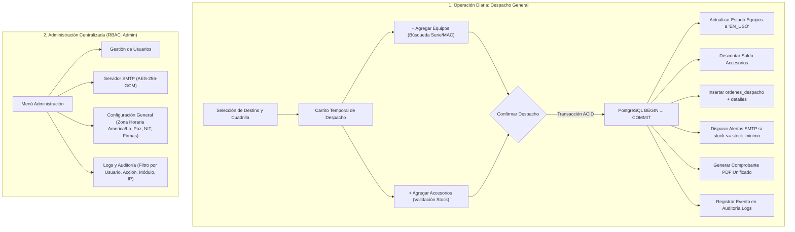
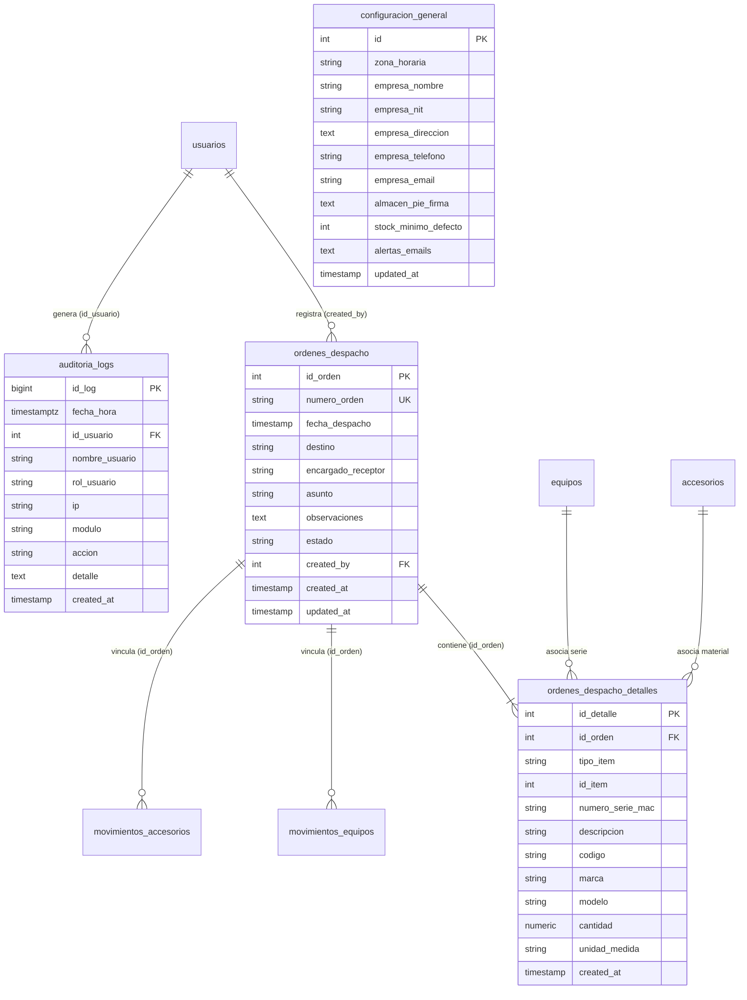

# SPECIFICATION: Despacho General Unificado, Transaccionalidad ACID y Administración Centralizada
<!-- Spec Kit Specification Document: SPEC-004 -->

**Identificador:** `SPEC-004`  
**Título:** Orden de Salida Unificada (Equipos + Accesorios), Kardex Transaccional, Administración Centralizada, Zona Horaria y Auditoría de Sistema  
**Estado:** `Propuesto`  
**Fecha:** Noviembre 2026  
**Skills de Referencia:**  
- [`.agents/skills/wms-ui-pro/SKILL.md`](file:///c:/Users/raul1/Desktop/soporte/proyectos%20desarrollo/almacen%20v2/.agents/skills/wms-ui-pro/SKILL.md) (AdminLTE v4, Bootstrap 5.3, Multi-Tema Claro/Noche/Alto Contraste, Tablas Full-Width y Modales Flotantes)  
- [`.agents/skills/nodejs-security-audit/SKILL.md`](file:///c:/Users/raul1/Desktop/soporte/proyectos%20desarrollo/almacen%20v2/.agents/skills/nodejs-security-audit/SKILL.md) (Auditoría SAST, Hardening Express, RBAC Estricto, Anti-IDOR, Transacciones ACID, Logs Inmutables)  
**Base Tecnológica:** Node.js 22 LTS / Express 4 / PostgreSQL 14+ / TypeScript 5 / AdminLTE 4 (Bootstrap 5.3) / EJS / PDFKit / ExcelJS / Nodemailer  

---

## 1. Resumen Ejecutivo y Motivación

Con la implementación de la seguridad base, el control de acceso por roles y los servicios SMTP de la [`SPEC-003`](file:///c:/Users/raul1/Desktop/soporte/proyectos%20desarrollo/almacen%20v2/.specify/specs/003-seguridad-usuarios-smtp-reportes/spec.md), el Sistema de Almacén TOI requiere resolver dos cuellos de botella operativos críticos para las operaciones diarias de telecomunicaciones:

1. **Fragmentación en la Entrega de Materiales y Ambigüedad de Conceptos:**  
   Actualmente, el sistema utiliza el término ambiguo *"Mover / Movimientos"*, y obliga al operador a realizar operaciones separadas para registrar la entrega de equipos (routers, ONTs, switches) y de accesorios/consumibles (bobinas de fibra, conectores, patch cords, splitters) que salen en una misma salida a cuadrilla o proyecto. Esto genera comprobantes desconectados y retrabajo administrativo.  
   Esta especificación estandariza la terminología a **"Despacho / Despachar"** e introduce el flujo de **"Despacho General" (Orden de Salida Unificada)**: un carrito de preparación interactivo que permite consolidar múltiples equipos y materiales en una única orden transaccional atómica (`BEGIN ... COMMIT / ROLLBACK`), con número correlativo único (`DSP-YYYYMMDD-XXXX`), verificación en tiempo real de stock, disparadores de alertas SMTP y emisión de un **Comprobante de Despacho Unificado en PDF**.

2. **Carencia de Administración Centralizada, Control de Zona Horaria y Trazabilidad:**  
   El sistema carece de un panel para configurar parámetros institucionales (nombre corporativo, NIT, dirección, firmas para PDFs), la zona horaria unificada (requerida en `America/La_Paz` UTC-4 para evitar desfases horarios en registros y reportes) y los umbrales globales de stock. Además, no existe un registro formal de auditoría (*Audit Logging*) que rastree quién inició sesión, qué cambios se efectuaron en la gestión maestra o qué despachos se emitieron o anularon.  
   Esta especificación consolida el módulo **Administración** (protegido por `requireRole(['admin'])`) en cuatro pilares: **Usuarios**, **Servidor SMTP**, **Configuración General del Sistema** y **Logs de Auditoría**.



---

## 2. Historias de Usuario (User Stories)

### US-1: Operador de Bodega - Preparación y Despacho Unificado en Una Sola Orden
* **Como** operador de turno en bodega de telecomunicaciones,  
* **Quiero** contar con una pantalla de "Despacho General" que me permita seleccionar la cuadrilla/proyecto receptor e ir agregando a una lista interactiva tanto equipos específicos (escaneando o buscando por serie/MAC) como accesorios (indicando cantidad con validación de stock disponible),  
* **Para** despachar toda la dotación de una cuadrilla de instalación en una única orden oficial sin tener que registrar múltiples movimientos dispersos.

#### Criterios de Aceptación (Gherkin):
```gherkin
Escenario: Validación de stock en tiempo real en el carrito
  Dado que el operador agrega un accesorio con stock actual de 15 unidades
  Cuando intenta ingresar una cantidad de 20 unidades en el carrito
  Entonces la interfaz debe marcar el campo en error impidiendo agregar el ítem
  Y mostrar el mensaje "Stock insuficiente: solo hay 15 unidades disponibles".

Escenario: Emisión exitosa de orden unificada atómica
  Dado que el carrito contiene 2 equipos por serie y 3 accesorios con cantidades válidas
  Cuando el operador presiona "Confirmar Despacho"
  Entonces el backend debe ejecutar una transacción atómica:
    - Crear el registro en "ordenes_despacho" con correlativo "DSP-YYYYMMDD-XXXX"
    - Registrar cada ítem en "ordenes_despacho_detalles"
    - Descontar el stock de los 3 accesorios y cambiar el estado de los 2 equipos a "EN_USO"
    - Guardar el ID del usuario en sesión en "created_by"
  Y redirigir con mensaje de éxito ofreciendo la descarga inmediata del PDF de remisión.
```

### US-2: Técnico / Cuadrilla Receptora - Comprobante de Entrega Formal Unificado
* **Como** líder técnico de cuadrilla o responsable de proyecto,  
* **Quiero** recibir un Comprobante de Despacho en PDF impreso o digital con el membrete oficial de la empresa, que detalle claramente todos los equipos entregados (con código, marca, modelo y serie/MAC) y todos los materiales (con cantidad y unidad de medida),  
* **Para** firmar la recepción conforme y respaldar ante la gerencia los activos y consumibles que llevo al campo.

#### Criterios de Aceptación (Gherkin):
```gherkin
Escenario: Generación de Comprobante PDF Unificado
  Dado un despacho registrado con número "DSP-20261115-0012"
  Cuando se descarga o imprime el comprobante desde "/despachos/comprobante/12"
  Entonces el PDF generado debe incluir:
    - Membrete con datos institucionales (Empresa, NIT, Dirección, Teléfono)
    - Número de despacho, fecha/hora en zona horaria local, destino y encargado
    - Tabla unificada de equipos (series monoespaciadas) y accesorios (cantidades tabulares)
    - Recuadros de firma formal: "Entregado por (Almacén)" y "Recibido Conforme (Cuadrilla)"
```

### US-3: Administrador del Sistema - Parámetros Institucionales y Zona Horaria
* **Como** administrador general de TOI,  
* **Quiero** configurar en una vista dedicada los parámetros de la empresa (Razón Social, NIT, dirección, teléfono, pie de firma en reportes), definir la Zona Horaria del sistema (`America/La_Paz` por defecto) y fijar el umbral global de stock mínimo junto a los correos destinatarios de alertas,  
* **Para** que toda la documentación y alertas salgan con datos corporativos correctos y las fechas se sincronicen exactamente a la hora boliviana sin desfases de UTC.

#### Criterios de Aceptación (Gherkin):
```gherkin
Escenario: Persistencia y aplicación de la Zona Horaria
  Dado que el administrador selecciona la zona horaria "America/La_Paz" (UTC-4)
  Cuando guarda la configuración general
  Entonces el servidor debe aplicar la zona horaria en el proceso Node.js y formateadores de fecha
  Y todas las vistas, reportes Excel, PDFs y logs deben desplegar la hora local boliviana.
```

### US-4: Auditor / Administrador - Trazabilidad y Logs de Seguridad Inmutables
* **Como** oficial de cumplimiento y administrador de seguridad,  
* **Quiero** consultar una bitácora centralizada de eventos del sistema (inicios de sesión, cambios en gestión maestra, despachos confirmados, anulaciones y cambios de configuración SMTP), con filtros por usuario, fecha, módulo y tipo de acción,  
* **Para** detectar actividades sospechosas, auditar errores humanos y contar con un registro inmutable de trazabilidad conforme a buenas prácticas OWASP.

#### Criterios de Aceptación (Gherkin):
```gherkin
Escenario: Registro automático de evento en la bitácora
  Dado que un usuario realiza una acción clave (ej. inicio de sesión fallido o confirmación de despacho)
  Cuando la petición es procesada por el servidor
  Entonces el sistema debe registrar en "auditoria_logs" de forma inmutable:
    - Fecha y hora exacta en zona horaria local
    - ID y nombre del usuario (o "ANÓNIMO" si falló login)
    - Dirección IP del cliente
    - Módulo y Tipo de Acción
    - Detalle estructurado de la operación realizada.
```

---

## 3. Matriz de Roles y Permisos (RBAC & IDOR Matrix)

| Módulo / Funcionalidad | Ruta HTTP / Acción | Rol Administrador (`admin`) | Rol Usuario (`usuario`) | Control Backend |
| :--- | :--- | :---: | :---: | :--- |
| **Nuevo Despacho General** | `GET /despachos/nuevo` | Permitido | Permitido | `requireAuth` |
| **Confirmar Despacho** | `POST /despachos/confirmar` | Permitido | Permitido | `requireAuth` + Transacción SQL |
| **Historial de Despachos** | `GET /despachos` | Ver todos los despachos | Ver únicamente sus despachos | Anti-IDOR (`created_by = userId`) |
| **Detalle de Despacho (Modal)** | `GET /api/despachos/:id` | Consulta libre | Solo si `created_by == userId` | 403 Forbidden si es ajeno |
| **Comprobante PDF Despacho** | `GET /despachos/comprobante/:id` | Descarga libre | Solo si `created_by == userId` | 403 Forbidden si es ajeno |
| **Anular Despacho** | `POST /despachos/anular/:id` | Permitido | Denegado (403) | `requireAdmin` + Reversa atómica |
| **Configuración General** | `GET /administracion/configuracion` | Acceso y Edición | Denegado (403) | `requireAdmin` |
| **Guardar Configuración** | `POST /administracion/configuracion` | Permitido | Denegado (403) | `requireAdmin` |
| **Logs de Auditoría** | `GET /administracion/logs` | Acceso con filtros y paginado | Denegado (403) | `requireAdmin` |
| **Gestión de Usuarios** | `GET /usuarios`, `POST /usuarios/*` | Acceso total | Denegado (403) | `requireAdmin` |
| **Servidor SMTP** | `GET /configuracion/smtp`, `POST ...` | Acceso total | Denegado (403) | `requireAdmin` |

---

## 4. Modelo de Datos y Transaccionalidad ACID

### 4.1 Diagrama Entidad-Relación (Mermaid)



### 4.2 Esquema de Base de Datos (Migración SQL: `004_despacho_and_admin.sql`)

```sql
-- 1. Tabla de Órdenes de Despacho General Unificadas
CREATE TABLE IF NOT EXISTS ordenes_despacho (
    id_orden SERIAL PRIMARY KEY,
    numero_orden VARCHAR(50) NOT NULL UNIQUE,
    fecha_despacho TIMESTAMP WITHOUT TIME ZONE NOT NULL DEFAULT CURRENT_TIMESTAMP,
    destino VARCHAR(150) NOT NULL,
    encargado_receptor VARCHAR(150) NOT NULL,
    asunto VARCHAR(200) NOT NULL,
    observaciones TEXT,
    estado VARCHAR(30) NOT NULL DEFAULT 'COMPLETADO', -- 'COMPLETADO', 'ANULADO'
    created_by INTEGER REFERENCES usuarios(id_usuario) ON DELETE SET NULL,
    created_at TIMESTAMP WITHOUT TIME ZONE DEFAULT CURRENT_TIMESTAMP,
    updated_at TIMESTAMP WITHOUT TIME ZONE DEFAULT CURRENT_TIMESTAMP
);

CREATE INDEX IF NOT EXISTS idx_ordenes_despacho_fecha ON ordenes_despacho(fecha_despacho DESC);
CREATE INDEX IF NOT EXISTS idx_ordenes_despacho_created_by ON ordenes_despacho(created_by);
CREATE INDEX IF NOT EXISTS idx_ordenes_despacho_numero ON ordenes_despacho(numero_orden);

-- 2. Tabla de Detalles de Orden de Despacho (Equipos + Accesorios)
CREATE TABLE IF NOT EXISTS ordenes_despacho_detalles (
    id_detalle SERIAL PRIMARY KEY,
    id_orden INTEGER NOT NULL REFERENCES ordenes_despacho(id_orden) ON DELETE CASCADE,
    tipo_item VARCHAR(20) NOT NULL CHECK (tipo_item IN ('EQUIPO', 'ACCESORIO')),
    id_item INTEGER,
    numero_serie_mac VARCHAR(100),
    descripcion VARCHAR(255) NOT NULL,
    codigo VARCHAR(100),
    marca VARCHAR(100),
    modelo VARCHAR(100),
    cantidad NUMERIC(10, 2) NOT NULL DEFAULT 1,
    unidad_medida VARCHAR(50) DEFAULT 'UNIDAD',
    created_at TIMESTAMP WITHOUT TIME ZONE DEFAULT CURRENT_TIMESTAMP
);

CREATE INDEX IF NOT EXISTS idx_ordenes_detalles_orden ON ordenes_despacho_detalles(id_orden);
CREATE INDEX IF NOT EXISTS idx_ordenes_detalles_serie ON ordenes_despacho_detalles(numero_serie_mac);

-- 3. Vinculación con movimientos existentes para compatibilidad total
ALTER TABLE movimientos_equipos 
    ADD COLUMN IF NOT EXISTS id_orden INTEGER REFERENCES ordenes_despacho(id_orden) ON DELETE SET NULL,
    ADD COLUMN IF NOT EXISTS numero_orden VARCHAR(50);

ALTER TABLE movimientos_accesorios 
    ADD COLUMN IF NOT EXISTS id_orden INTEGER REFERENCES ordenes_despacho(id_orden) ON DELETE SET NULL,
    ADD COLUMN IF NOT EXISTS numero_orden VARCHAR(50);

CREATE INDEX IF NOT EXISTS idx_mov_eq_id_orden ON movimientos_equipos(id_orden);
CREATE INDEX IF NOT EXISTS idx_mov_acc_id_orden ON movimientos_accesorios(id_orden);

-- 4. Tabla de Configuración General del Sistema
CREATE TABLE IF NOT EXISTS configuracion_general (
    id SERIAL PRIMARY KEY,
    zona_horaria VARCHAR(50) NOT NULL DEFAULT 'America/La_Paz',
    empresa_nombre VARCHAR(150) NOT NULL DEFAULT 'Telecomunicaciones Oportunas Inteligentes (TOI)',
    empresa_nit VARCHAR(50) DEFAULT '1029384021',
    empresa_direccion TEXT DEFAULT 'Av. Principal #123, Zona Sur, La Paz - Bolivia',
    empresa_telefono VARCHAR(50) DEFAULT '+591 2 2456789',
    empresa_email VARCHAR(100) DEFAULT 'contacto@toi.bo',
    almacen_pie_firma TEXT DEFAULT 'Documento oficial de entrega y custodia de materiales de red y telecomunicaciones.',
    stock_minimo_defecto INTEGER NOT NULL DEFAULT 10,
    alertas_emails TEXT DEFAULT 'almacen@toi.bo, supervisores@toi.bo',
    updated_at TIMESTAMP WITHOUT TIME ZONE DEFAULT CURRENT_TIMESTAMP
);

-- Insertar configuración inicial por defecto si está vacía
INSERT INTO configuracion_general (id, zona_horaria, empresa_nombre, stock_minimo_defecto)
VALUES (1, 'America/La_Paz', 'Telecomunicaciones Oportunas Inteligentes (TOI)', 10)
ON CONFLICT (id) DO NOTHING;

-- 5. Tabla de Auditoría y Bitácora de Seguridad (Audit Logs)
CREATE TABLE IF NOT EXISTS auditoria_logs (
    id_log BIGSERIAL PRIMARY KEY,
    fecha_hora TIMESTAMP WITH TIME ZONE NOT NULL DEFAULT CURRENT_TIMESTAMP,
    id_usuario INTEGER REFERENCES usuarios(id_usuario) ON DELETE SET NULL,
    nombre_usuario VARCHAR(100) NOT NULL DEFAULT 'SISTEMA',
    rol_usuario VARCHAR(30) NOT NULL DEFAULT 'SISTEMA',
    ip VARCHAR(50) NOT NULL DEFAULT '127.0.0.1',
    modulo VARCHAR(50) NOT NULL,
    accion VARCHAR(50) NOT NULL,
    detalle TEXT,
    created_at TIMESTAMP WITHOUT TIME ZONE DEFAULT CURRENT_TIMESTAMP
);

CREATE INDEX IF NOT EXISTS idx_auditoria_fecha ON auditoria_logs(fecha_hora DESC);
CREATE INDEX IF NOT EXISTS idx_auditoria_usuario ON auditoria_logs(id_usuario);
CREATE INDEX IF NOT EXISTS idx_auditoria_modulo ON auditoria_logs(modulo);
CREATE INDEX IF NOT EXISTS idx_auditoria_accion ON auditoria_logs(accion);
```

---

## 5. Especificación de Endpoints y Contratos de API

### 5.1 Módulo Despacho General

| Método | Endpoint | Middleware | Descripción |
| :--- | :--- | :--- | :--- |
| `GET` | `/despachos` | `requireAuth` | Vista principal: Historial de Despachos y Kardex (Anti-IDOR según rol). |
| `GET` | `/despachos/nuevo` | `requireAuth` | Interfaz de preparación del Despacho General con Carrito interactivo. |
| `POST` | `/despachos/confirmar` | `requireAuth` | Procesa la orden de salida unificada dentro de transacción ACID. |
| `GET` | `/despachos/comprobante/:id` | `requireAuth` | Emite el Comprobante de Despacho Unificado en PDF (Anti-IDOR). |
| `GET` | `/api/despachos/:id/detalle` | `requireAuth` | Retorna en JSON el detalle de ítems de una orden para visualizar en modal. |
| `POST` | `/despachos/anular/:id` | `requireAdmin` | Anula una orden y revierte stock de equipos y accesorios atómicamente. |

#### Contrato Payload: `POST /despachos/confirmar`
```json
{
  "destino": "Nodo Sur - Cuadrilla Fibra 3",
  "encargado_receptor": "Juan Perez (Técnico Redes)",
  "asunto": "Instalación enlace fibra y CPEs cliente corporativo",
  "observaciones": "Material entregado con precinto de seguridad.",
  "items": [
    {
      "tipo_item": "EQUIPO",
      "id_equipo": 45,
      "numero_serie_mac": "GPON007093E8",
      "descripcion": "ONT Huawei HG8245H5",
      "cantidad": 1
    },
    {
      "tipo_item": "ACCESORIO",
      "id_accesorio": 12,
      "descripcion": "Bobina Drop Fibra Óptica 1 Hilo (1000m)",
      "cantidad": 2,
      "unidad_medida": "BOBINA"
    },
    {
      "tipo_item": "ACCESORIO",
      "id_accesorio": 8,
      "descripcion": "Conector Rápido SC/APC",
      "cantidad": 20,
      "unidad_medida": "UNIDAD"
    }
  ]
}
```

### 5.2 Módulo Administración

| Método | Endpoint | Middleware | Descripción |
| :--- | :--- | :--- | :--- |
| `GET` | `/administracion/configuracion` | `requireAdmin` | Vista de Configuración General: Zona Horaria, Datos Corporativos y Alertas. |
| `POST` | `/administracion/configuracion` | `requireAdmin` | Actualiza la configuración institucional y la zona horaria del sistema. |
| `GET` | `/administracion/logs` | `requireAdmin` | Vista de Logs de Auditoría: Tabla paginada con filtros multicriterio. |
| `GET` | `/administracion/logs/exportar/excel` | `requireAdmin` | Exporta la bitácora filtrada a Excel (`.xlsx`). |

---

## 6. Diseño de Interfaz y Ergonomía (Skill: `wms-ui-pro`)

Todas las pantallas deben satisfacer rigurosamente las especificaciones de `.agents/skills/wms-ui-pro/SKILL.md`:

1. **Estructura del Menú Lateral (`src/views/layouts/sidebar.ejs`):**
   - Agrupador **"Despacho y Operaciones"**:
     - `+ Nuevo Despacho General` (`/despachos/nuevo`) con badge `Nuevo`.
     - `Historial de Despachos` (`/despachos`).
     - `Despacho de Equipos` (`/movimientos/equipos`).
     - `Despacho de Materiales` (`/movimientos/accesorios`).
     - `Kardex y Reportes` (`/reportes`).
   - Agrupador **"Administración"** (con badge `Admin` visible solo para administradores):
     - `Gestión de Usuarios` (`/usuarios`).
     - `Configuración del Sistema` (`/administracion/configuracion`).
     - `Servidor SMTP` (`/configuracion/smtp`).
     - `Logs y Auditoría` (`/administracion/logs`).

2. **Pantalla "Nuevo Despacho General" (`src/views/despachos/nuevo.ejs`):**
   - **Formato a 2 Bloques Limpios:**
     - **Cabecera de Orden (Card Superior):** Destino (con datalist de cuadrillas/proyectos frecuentes), Encargado Receptor, Asunto y Observaciones.
     - **Constructor Interactivo de Despacho (Card Inferior):**
       - Selector de tipo: `[ Equipo por Serie/MAC ]` vs `[ Accesorio / Material por Cantidad ]`.
       - Selector/buscador reactivo con autocompletado y visualización inmediata del stock disponible en badge verde o rojo.
       - Botón destacado `+ Agregar a la Orden`.
       - **Tabla del Carrito de Despacho (100% Ancho):** Muestra ítems agregados con badges semánticos (`EQUIPO`, `ACCESORIO`), series en fuente monoespaciada (`font-mono`), cantidades tabulares (`font-tabular`) y botón de eliminación por fila (`<i class="bi bi-trash"></i>`).
       - Resumen numérico inferior: *"Total Ítems: X (Y Equipos, Z Materiales)"*.
       - Botón primario de confirmación: `<button class="btn btn-success btn-lg px-4"><i class="bi bi-check2-circle me-2"></i> Emitir Orden de Despacho</button>`.

3. **Historial de Despachos (`src/views/despachos/index.ejs`):**
   - Tabla completa a ancho 100% (`col-12`) con DataTables/filtro rápido.
   - Columnas: `N° ORDEN` (mono), `FECHA/HORA` (local), `DESTINO`, `ENCARGADO`, `TOTAL ÍTEMS`, `ESTADO`, `OPERADOR`, `ACCIONES`.
   - Botón de acción `Ver Detalle` que abre un modal flotante centrado (`modal-lg modal-dialog-centered`) con la lista desglosada de equipos y materiales entregados.
   - Botón directo `Imprimir / PDF` que descarga la remisión formal.

4. **Configuración General (`src/views/administracion/configuracion.ejs`):**
   - Formulario en tarjetas Bootstrap 5.3 con pestañas o secciones claras:
     - **Zona Horaria y Región:** Dropdown con zonas horarias estándar IANA (`America/La_Paz`, `America/Lima`, `America/Santiago`, etc.).
     - **Identidad Corporativa:** Razón social, NIT, dirección, teléfono, correo de contacto y pie de firma para comprobantes.
     - **Políticas Operativas:** Stock mínimo por defecto y correos destinatarios de alertas.
   - Uso estricto de clases adaptativas (`bg-body`, `bg-body-tertiary`, `text-body`, `form-control`, `form-select`) para compatibilidad en Modo Claro, Modo Noche y Alto Contraste.

5. **Bitácora de Auditoría (`src/views/administracion/logs.ejs`):**
   - Tabla de ancho completo (`col-12`) con filtro colapsable por Fechas, Usuario, Módulo (`AUTENTICACION`, `DESPACHOS`, etc.) y Acción.
   - Paginación dinámica y badges de colores sólidos por tipo de evento (`SUCCESS` en verde, `FAILED/DELETE` en rojo, `UPDATE` en azul, `CONFIG` en violeta).
   - Botón para exportar el resultado a Excel (`.xlsx`) con `exceljs`.

---

## 7. Auditoría de Seguridad y Hardening (Skill: `nodejs-security-audit`)

1. **Transacciones ACID Seguras en PostgreSQL:**
   - La emisión de un despacho involucra al menos 4 tablas (`ordenes_despacho`, `ordenes_despacho_detalles`, `equipos` y `accesorios`). Toda la lógica debe ejecutarse mediante un cliente dedicado obtenido del pool (`const client = await pool.connect()`):
     - `await client.query('BEGIN');`
     - Validar que las series de los equipos no hayan sido despachadas por otro operador concurrente (`SELECT estado FROM equipos WHERE ... FOR UPDATE`).
     - Validar que el stock de cada accesorio sea suficiente (`SELECT stock FROM accesorios WHERE ... FOR UPDATE`).
     - Realizar las inserciones y deducciones.
     - `await client.query('COMMIT');`
     - En el bloque `catch`: `await client.query('ROLLBACK');` para garantizar que jamás queden estados inconsistentes.
     - En el bloque `finally`: `client.release();`.

2. **Middleware de Auditoría Automático (`auditLogger`):**
   - Crear el servicio `AuditService.log(req, { modulo, accion, detalle })` que extraiga automáticamente:
     - `ip`: Soporte para proxies mediante `req.headers['x-forwarded-for'] || req.socket.remoteAddress`.
     - `id_usuario`: ID de sesión o `null`.
     - `nombre_usuario`: Nombre de sesión o `'ANÓNIMO'`.
     - `fecha_hora`: Fecha y hora actual con precisión de milisegundos.

3. **Prevención de IDOR en Despachos:**
   - Si un usuario con rol `usuario` consulta un despacho (`/despachos/comprobante/:id` o `/api/despachos/:id/detalle`), el controlador verifica que `orden.created_by === req.session.userId`. Si no coincide, retorna `403 Forbidden` y registra una alerta en los logs de auditoría.

4. **Manejo Seguro de Zona Horaria en Node.js:**
   - La zona horaria configurada en la BD (`configuracion_general.zona_horaria`) debe inyectarse en el entorno del proceso Node.js (`process.env.TZ = zona_horaria`) y utilizarse en formateadores `Intl.DateTimeFormat` para garantizar coherencia en PDFs, Excel y vistas web.

---

## 8. Criterios de Aceptación y Plan de Validación

1. **Terminología Uniforme:** Toda la interfaz debe mostrar "Despachos / Despachar" en lugar de "Movimientos / Mover".
2. **Carrito de Despacho Operativo:** La vista `/despachos/nuevo` permite agregar equipos y materiales, impidiendo agregar accesorios con cantidades mayores al stock real o equipos no disponibles.
3. **Atomicidad SQL Verificada:** Si falla la inserción de un accesorio dentro de un despacho que contenía 3 equipos, ningún equipo debe cambiar su estado a `EN_USO` y no debe crearse ninguna orden huérfana.
4. **Comprobante PDF Unificado:** El PDF generado por una orden contiene en un solo documento los equipos (con series y MACs) y los accesorios, con el membrete institucional configurado y recuadros de firma.
5. **Configuración General y Zona Horaria:** El administrador puede cambiar la razón social, NIT y zona horaria (`America/La_Paz`), verificando que los nuevos comprobantes y reportes reflejen inmediatamente los datos actualizados.
6. **Bitácora de Auditoría en Tiempo Real:** Toda operación sensible (login fallido, confirmación de despacho, cambio de SMTP) genera un registro visible en `/administracion/logs`.
7. **Diseño Multi-Tema Impecable:** Las nuevas pantallas (`/despachos/nuevo`, `/despachos`, `/administracion/configuracion`, `/administracion/logs`) responden fluidamente en Modo Claro, Modo Noche y Alto Contraste sin cajas blancas sueltas.
